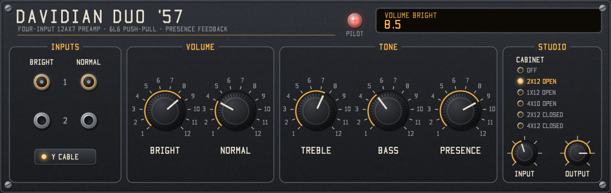

# Davidian Duo '57

A circuit-modelled guitar amplifier plugin (LV2, VST3 and Audio Unit), solved stage by stage from the service diagram of a classic 1957 tweed 2x12 combo: four input jacks on Normal and Bright channels, a treble/bass tone stack, presence, a 6L6GC push-pull power amp with rectifier sag, and five speaker cabinet models.

**A close model, not an exact copy.** It is a simulation of the circuit from its component values, not a sampled or measured amp, and some details are reasoned estimates (listed under [Estimates](#estimates)). It has not been compared side by side with a built unit, so expect it to sound close to the hardware rather than identical.



A mono amp with no latency (mono or stereo tracks work too), with the same GUI on every system. GPL-3.0-or-later.

| Format | Windows | macOS | Linux |
|---|---|---|---|
| LV2 | yes | yes | yes |
| VST3 | yes | yes | yes |
| Audio Unit | — | yes | — |

Every format runs the same amp code and the same panel. The VST3 is checked sample for sample against the LV2 build.

## Download

Ready-made builds are on the [Releases page](https://github.com/evadavevadave/davidian-duo-57/releases). Each zip holds every format for one system, side by side, each with its licences:

| Download | Contains | For |
|---|---|---|
| `Davidian-Duo-57-<version>-windows-x64.zip` | LV2 and VST3 (Win32 GUI) | Windows 10/11, 64-bit hosts |
| `Davidian-Duo-57-<version>-macos-universal.zip` | LV2, VST3 and Audio Unit (Cocoa GUI) | macOS 10.13 or later, Apple silicon and Intel |
| `Davidian-Duo-57-<version>-linux-x64.zip` | LV2 and VST3 (X11 GUI) | 64-bit Intel/AMD Linux |
| `Davidian-Duo-57-<version>-linux-arm64.zip` | LV2 and VST3 (X11 GUI) | 64-bit ARM Linux |

`SHA256SUMS.txt` on the release page lists each zip's checksum. Unzip, copy the format your host uses into its plugin folder, and restart your host (or rescan plugins):

| Format | Copy | Into |
|---|---|---|
| LV2 (Windows) | `duo57.lv2` | `%APPDATA%\LV2` (create it if it doesn't exist) |
| LV2 (macOS) | `duo57.lv2` | `~/Library/Audio/Plug-Ins/LV2` |
| LV2 (Linux) | `duo57.lv2` | `~/.lv2` |
| VST3 (Windows) | `Davidian Duo 57.vst3` | `C:\Program Files\Common Files\VST3` |
| VST3 (macOS) | `Davidian Duo 57.vst3` | `~/Library/Audio/Plug-Ins/VST3` |
| VST3 (Linux) | `Davidian Duo 57.vst3` | `~/.vst3` |
| Audio Unit (macOS) | `Davidian Duo 57.component` | `~/Library/Audio/Plug-Ins/Components` |

In the host it is listed as **Davidian Duo '57** (LV2), **Duo '57** by Davidian (VST3) or **Davidian: Duo '57** (Audio Unit). Replace any older copy instead of keeping two: when two bundles have the same URI, the loader uses one and ignores the other. If your host doesn't scan the LV2 folder, add it to the host's LV2 search path or set the `LV2_PATH` environment variable. The LV2 URI is `urn:davidian:duo-57`; the Audio Unit is `aufx Du57 Dvdn`.

The macOS builds are ad hoc signed but not notarized, so macOS may block them after download. Run this once in Terminal for each format you copied:

```bash
xattr -dr com.apple.quarantine ~/Library/Audio/Plug-Ins/LV2/duo57.lv2
```

```bash
xattr -dr com.apple.quarantine "$HOME/Library/Audio/Plug-Ins/VST3/Davidian Duo 57.vst3"
```

```bash
xattr -dr com.apple.quarantine "$HOME/Library/Audio/Plug-Ins/Components/Davidian Duo 57.component"
```

The VST3 and Audio Unit have their own bypass, which fades over 10 ms (VST3) or passes the input straight through (Audio Unit).

## Controls

| Panel | Control | Circuit part |
|---|---|---|
| Inputs | Bright 1, Bright 2, Normal 1, Normal 2, Y Cable | The four input jacks; click one to plug into it, and it lights amber. Input 1 is about 6 dB hotter than Input 2. Y Cable feeds Normal 1 and Bright 1 together. Default Bright 1 |
| Volume | Bright, Normal | R19 / R18 1M. Bright has C4 100 pF across the pot. The unused channel's volume still loads the mixer, as on the real amp. Default 6 |
| Tone | Treble | R26 1M "A", with C7 250p and C8 47p. Default 7 |
| Tone | Bass | R30 1M "A", with C9 .01, C10 .0047 and R27/R28/R29 220k. Default 5 |
| Tone | Presence | R31 5k + C11 .1µF on the V4-A cathode. Turning it up lifts the treble and reduces treble in the negative feedback. Default 6 |
| Studio | Cabinet | Not on the amp: Off, 2x12 Open, 1x12 Open, 4x10 Open, 2x12 Closed or 4x12 Closed (see [Cabinets](#cabinets)). Off leaves the speaker-terminal signal for your own impulse response. Default 2x12 Open |
| Studio | Input | Input trim, -24 to +24 dB: 0 dBFS at the input counts as 1 V peak at the guitar jack |
| Studio | Output | Not on the amp: output level, -60 to +12 dB. It comes after the circuit and doesn't change the tone |

Volume, Treble, Bass and Presence carry a 1–12 scale, as on a tweed amp. The red pilot jewel is decoration and always lit. The readout at the top right shows the control you last touched and its value.

Drag a knob up or down, hold Shift to fine-tune, use the mouse wheel, and double-click to reset. Click a cabinet row to choose it, or use the mouse wheel over the list.

### Cabinets

| Cabinet | Character |
|---|---|
| 2x12 Open | The amp's own speakers: open back, alnico magnets. Loose bass, a gentle mid scoop and a soft top. The default |
| 1x12 Open | A single 12" in an open-back cab. Less low end and more forward upper mids |
| 4x10 Open | Four 10" in an open-back cab. Deep but loose bass with a softer, earlier top roll-off |
| 2x12 Closed | The same two 12" in a sealed box. Tighter bass with a box thump around 100 Hz |
| 4x12 Closed | A sealed 4x12 with ceramic speakers. The biggest low end, a deeper mid scoop and a bright break-up peak |

Each cabinet is level-matched to the stock 2x12 over 100 Hz–5 kHz, so switching changes the tone rather than the volume; `render` checks they stay within 3 dB (they measure within 0.6 dB). Switching crossfades over 20 ms, so it doesn't click. The Cabinet port's values 0 and 1 mean the same as the old on/off switch, so sessions saved with it load unchanged.

## How it is modelled

All in `src/duo57.c`, with the service diagram's part values.

- **Input section:** four 12AX7 triodes (V1-A/B Normal, V2-A/B Bright). They share R9 470R ‖ C1 220µF, use 100k plate loads, and each pair is mixed through 100k resistors.
- **Volume and mixer:** the volume pots are modelled as Thevenin sources into the R20/R21 270k mixer, with the V3-A grid's input (Miller) capacitance.
- **V3 stages:** V3-A and the V3-B cathode follower are DC-coupled, so they are solved as one table. This includes grid conduction of the cathode follower through R23, and the R22 10M shunt-feedback loop, solved implicitly every sample.
- **Tone stack:** the full RC network, including the V4-A input capacitance, solved by nodal analysis with trapezoidal capacitor models. It is not a fitted curve.
- **V4-A and feedback:** V4-A has an unbypassed cathode. The R32 56k negative feedback from the speaker enters its cathode, and presence shapes both the stage gain and the feedback.
- **Phase inverter:** a cathodyne (V4-B), with swing limits.
- **Power amp:** 6L6GC push-pull, biased at −50.2 V for 33.3 mA per tube (note 7 on the schematic), with output-transformer bandwidth and plate saturation. The feedback loop is solved implicitly every sample.
- **Blocking:** power-tube grid current charges C13/C14, which shifts the bias the way a cranked tweed amp does.
- **Rectifier sag:** 5U4 rectifiers, choke and 22µF reservoir.
- **Triodes:** every 12AX7 stage uses the Koren equations, solved on that stage's AC load line into a lookup table when the plugin loads.
- **Oversampling:** everything runs at 4x with 12th-order anti-alias filters. The plugin adds no latency.

### Checked against the schematic

The schematic prints DC voltages at four test points, AC levels at six more, and an output test. `render` checks all of them on every build.

**DC operating points** (from the valve models and the circuit's resistors; nothing is fitted to these):

| Point | Model | Schematic | Difference |
|---|---|---|---|
| TP8 (input cathodes) | 1.64 V | 1.73 V | −5% |
| TP9 (V3-A cathode) | 1.47 V | 1.55 V | −5% |
| TP10 (cathode follower) | 204 V | 197 V | +3% |
| TP11 (V4-A cathode) | 1.79 V | 1.93 V | −7% |

**AC test points** (note 6: 10 mV at 1 kHz into J3, Bright 1, with all controls at 50%; the schematic allows ±20%):

| Point | Model | Schematic | Difference |
|---|---|---|---|
| TP14 (C3 node) | 554 mV | 488 mV | +13% |
| TP15 (V3-A grid) | 57 mV | 50 mV | +13% |
| TP16 (cathode follower) | 2.92 V | 2.51 V | +16% |
| TP17 (V4-A grid) | 302 mV | 261 mV | +16% |
| TP23 (speaker, 4 Ω) | 3.23 V | 2.6 V | +24% |

**Output test:** the model gives 30.1 W at 5% THD into 4 Ω; the schematic calls for 30 W RMS. At full clipping it gives 43 W. The schematic gives no figure for that; Fender quotes 40 W for its later '57 Custom Twin.

The ratio across each stage matches the schematic. The +13% at the input carries through the whole chain. That comes from the 12AX7 model (Koren's published parameters), not from an estimate, so it is left as it is: a real valve's gain varies by more than that. Only the speaker test point ends up just outside the schematic's ±20%.

### Estimates

Each estimate was checked against the schematic, its parts list and published sources (see [Sources](#sources)), and changed where the schematic's own data settled it:

- **Input valves (confirmed):** all four input triodes are 12AX7s. The parts list gives four 7025/12AX7WA valves. Some retailers list 12AY7s, but that is the later '57 Custom Twin, a different amp.
- **Jack switching (confirmed):** Input 1 drives both triodes of its channel in parallel, and Input 2 drives one. The scan's jack drawing is ambiguous, but builders' reports of the 5E8-A agree, and only two parallel 12AX7s reach the schematic's TP14 gain of 48.8×. Input 1 is about 6 dB hotter.
- **Volume pots (fitted):** the parts list calls them "1M SPL D", a special taper the schematic doesn't define, and no published curve was found. The law is now set so the volume stage's loss (TP15/TP14) matches the schematic exactly. It sits at 47% of the resistance at half rotation, just under linear (it was linear before).
- **Treble and bass pots (fitted):** "1M A" audio pots. The audio curve is now set so the tone stack's loss (TP17/TP16) matches the schematic. It sits at 8.65% at half rotation (it was 10%, which left TP17 42% high). The stack's loss is very sensitive to this curve, and 8.65% is within the tolerance of real audio pots.
- **Power stage (fitted):** the plate saturation now has a harder knee, fitted to the schematic's output test of 30 W RMS at 5% THD. With the old, softer curve the model reached 5% THD at about 22 W.
- **Cabinet filters (estimate):** all five are shaped by ear from the usual character of each cabinet type, not from measured speakers or impulse responses. Their curves are in the `CABS` table in `src/duo57.c`. The stock cabinet stands in for the amp's two 8 Ω 12" alnico speakers.

### Simplifications

These parts are behavioural models, not a component-level circuit solution:

- the cathodyne's swing limits
- the 6L6GC, which uses a 3/2-power law
- output-transformer saturation
- rectifier sag
- the cabinet filters, which are six-band EQ curves rather than speaker models: they don't model cone break-up distortion, mic position or room

Power-supply ripple isn't modelled, and the preamp supply doesn't sag with the power amp.

## Build

The amp and the LV2 plugin are plain C, with no dependencies beyond the platform's own libraries: Win32 on Windows, Cocoa on macOS, Xlib on Linux. The macOS window layer is compiled as Objective-C. No LV2 SDK is needed; build with `-DHAVE_LV2` to use the system headers instead. The VST3 and Audio Unit wrappers are C++ on the Steinberg VST3 SDK and Apple's AudioUnitSDK, which CMake downloads while configuring.

| Source | What it is |
|---|---|
| `src/duo57.c` | The amp model, cabinet models, LV2 entry points and the engine API |
| `src/engine.h` | The amp as a small C API, for the VST3 and Audio Unit wrappers |
| `src/params.h` | The VST3 and Audio Unit parameters: ranges, defaults and names, as in the TTL |
| `src/ports.h` | Port numbers, cabinet numbers and URIs shared by every format and the GUI |
| `src/vst3/` | The VST3 plugin: processor, controller and editor |
| `src/au/` | The Audio Unit: the AUv2 effect, its Cocoa view and its Info.plist |
| `src/ui/ui_lv2.c` | LV2 GUI entry points |
| `src/ui/view.c`, `view.h` | The panel in a native window: Win32, Cocoa or X11. Shared by the LV2 GUI, the VST3 editor and the Audio Unit view |
| `src/ui/panel.h` | The panel: layout, drawing and mouse handling, with no platform code |
| `src/ui/style.h`, `canvas.h`, `font.h` | Davidian GUI house style: palette, software renderer and stroke font, copied unchanged from the Bi-Lumen |
| `src/lv2_core.h` | The LV2 C interface, so no SDK is needed |
| `duo57.lv2/` | LV2 metadata. The build fills in the library extension and GUI type in `manifest.ttl.in` |
| `CMakeLists.txt` | Builds every format, with the tests |

### Every format (CMake)

Needs CMake 3.25 or later, a C and C++ compiler, and git (to download the SDKs). On Linux, also the X11 and XCB headers that the VST3 SDK asks for; the CI workflow lists them. On macOS, the Xcode command-line tools.

```bash
cmake -S . -B build-cmake -DCMAKE_BUILD_TYPE=Release
```

```bash
cmake --build build-cmake --config Release
```

```bash
ctest --test-dir build-cmake -C Release
```

This builds `build-cmake/duo57.lv2`, `build-cmake/VST3/Release/Davidian Duo 57.vst3` and, on macOS, `build-cmake/AU/Davidian Duo 57.component`. For a universal macOS build, add `-DCMAKE_OSX_ARCHITECTURES="arm64;x86_64"`. To skip a format, add `-DDUO_VST3=OFF` or `-DDUO_AU=OFF`. Visual Studio ships a copy of CMake, and the VST3 SDK's validator runs on the plugin after every build.

### LV2 only, Windows (Visual Studio)

Needs Visual Studio with the C++ tools. `build.bat` finds them with `vswhere`, and builds `build\duo57.lv2`.

```bash
build.bat
```

### LV2 only, macOS, Linux, MinGW

Needs a C compiler and `make`. On Linux, also the X11 headers (`libx11-dev` on Debian/Ubuntu). On macOS, the Xcode command-line tools; the build is universal (Apple silicon and Intel) by default, and `make ARCH=` builds for this Mac's architecture only. The libraries get the right name for each system (`.so` or `.dylib`).

```bash
make
```

```bash
make install
```

`make install` copies the bundle to `~/.lv2` (set `LV2DIR` for another folder; on macOS use `LV2DIR=~/Library/Audio/Plug-Ins/LV2`). `make dist` zips the bundle for release.

## Tests

Windows:

```bash
build.bat test
```

macOS, Linux:

```bash
make test
```

With CMake, `ctest` runs `render`, `ui_render`, `params_check` and (on Windows) `vst3_check`.

- `render` checks the plugin against the schematic: the AC test-point levels, the two fitted stage ratios, the four DC operating points and the 5% THD output test. It renders a synthetic chord through five settings and through each cabinet to `build\test_*.wav`, checks that the cabinets are level-matched, and checks for NaN, glitches when switching input jacks or cabinets, and stability of the feedback loops. A single instance runs about 7–9 times faster than real time on the build machine.
- `ui_render` draws the panel to a BMP file: `build\ui_render.exe panel.bmp`.
- `ui_check` (Windows) loads the GUI the way a Windows host does and drives it with mouse messages: `build\ui_check.exe duo57.lv2 window.bmp`.
- `params_check` checks that the VST3 and Audio Unit parameters in `src/params.h` agree with the TTL and the panel, and that values round-trip through the host's 0–1 range and through text.
- `vst3_check` (Windows) loads the VST3 the way a host does. It drives the editor with mouse messages and checks that each click or drag reaches the host as one begin/perform/end edit. It also checks that the VST3 output matches the LV2 build sample for sample (it measures a difference of 0), and that bypass passes the input through.
- The Steinberg VST3 SDK's validator runs on the VST3 after every build (47 tests).
- In CI on macOS, Apple's `auval -strict` validates the Audio Unit, natively and through Rosetta for the Intel half.

GitHub Actions builds and tests on Windows (MSVC), the current macOS, and Ubuntu 22.04 on x64 and ARM for every push (see `.github/workflows/build.yml`). On Linux it also checks the LV2 bundle with the lilv parser that hosts use. The macOS and Linux GUIs are checked by compiling them and rendering the shared panel code, not by opening a window. Pushing a version tag publishes a release with a zip for each system.

## Use of AI

Made with generative AI (Claude Code, Anthropic's Claude Opus 5.5), directed and reviewed by Davidian. The code, tests, LV2 metadata, build scripts and this README were written by the AI.

- **The author** supplied the schematic, the GUI house style, the names and the licensing choices. They also decided what to build and changed parts of the result themselves, including renaming the project to Duo '57.
- **The AI**:
  - read component values and topology from the scanned schematic and chose the estimates listed under [Estimates](#estimates)
  - checked those estimates against the schematic's parts list and test points and against published sources, and fitted the pot curves and power stage to the schematic's data
  - wrote the DSP model and calibrated it against the schematic's test points
  - designed the five cabinet curves
  - adapted the house-style GUI to this panel, and the VST3 and Audio Unit wrappers from the Davidian Treble Booster 30
  - wrote the test programs, the build scripts and CI workflow, and the documentation
- **Checking:** the results are checked by the automated tests described above:
  - DC operating points, test-point levels and the output test against the schematic
  - numerical stability, jack and cabinet switching, cabinet levels and speed
  - the GUI loaded and driven by simulated mouse input (Windows: LV2 and VST3)
  - the VST3 against the LV2 build, sample for sample; Steinberg's validator; `auval` for the Audio Unit
  - builds and tests on Windows, macOS and Linux in CI
- **Not checked:** the sound hasn't been compared with a real amplifier, and the plugin hasn't been tried in a DAW yet. The macOS and Linux GUIs compile but haven't been opened in a host. The cabinet curves should be tuned by ear.

## References

The model re-implements equations from these published works. No code was copied from them.

- N. Koren, "Improved vacuum tube models for SPICE simulations", *Glass Audio* 8(5), 1996. The 12AX7 triode equation and parameters.
- R. Bristow-Johnson, "Cookbook formulae for audio EQ biquad filter coefficients" (the Audio EQ Cookbook). The low-pass, high-pass and peaking filters in the anti-alias and cabinet filters.
- V. Zavalishin, *The Art of VA Filter Design*, Native Instruments, 2012–2020. The topology-preserving one-pole filters.
- K. Karplus and A. Strong, "Digital synthesis of plucked-string and drum timbres", *Computer Music Journal* 7(2), 1983. Only used to make the test signal in `test/render.c`.

### Sources

Consulted when checking the [Estimates](#estimates). They are builders' and sellers' accounts, not manufacturer data, and the schematic's own data took precedence:

- [TDPRI: Tweed amps – 1 vs 2 input tubes for the standard 2-channel, 4-input circuits](https://www.tdpri.com/threads/tweed-amps-1-vs-2-input-tubes-for-fenders-standard-2-channel-4-input-circuits.592490/) and [Help with input jack wiring on 5e8a build](https://www.tdpri.com/threads/help-with-input-jack-wiring-on-5e8a-build.566285/): which input drives both triodes
- [Music Electronics Forum: tweed twin 5e8a parallel triodes](https://music-electronics-forum.com/forum/amplification/guitar-amps/theory-design/19802-tweed-twin-5e8a-parallel-triodes): the shared 470 Ω input cathode resistor
- [Music Electronics Forum: 5E8-A weird tone stack](https://music-electronics-forum.com/forum/amplification/guitar-amps/build-your-amp/tweed-builders/15351-5e8-a-wierd-tone-stack): pot tapers in the 5E8-A
- [Premier Guitar review of the '57 Custom Twin-Amp](https://www.premierguitar.com/fender-custom-57-twin-amp-review): the later reissue's valves and output, a different amp

## Licence

Copyright (C) 2026 Davidian. GPL-3.0-or-later: you can redistribute it and/or modify it under the terms of the GNU General Public License as published by the Free Software Foundation, either version 3 of the License, or (at your option) any later version. It is distributed in the hope that it will be useful, but WITHOUT ANY WARRANTY; without even the implied warranty of MERCHANTABILITY or FITNESS FOR A PARTICULAR PURPOSE. See [LICENSE](LICENSE) for the full text. Every source file starts with an SPDX licence line saying which licence applies to it.

### Third-party licences

| Component | Licence | How it's used |
|---|---|---|
| LV2 C interface (`lv2/core/lv2.h`, `lv2/ui/ui.h`) | ISC | Its declarations are re-stated in `src/lv2_core.h`, the UI ABI block of `src/ui/ui_lv2.c` and `test/ui_check.c`, so no LV2 SDK is needed. Copyright and permission notice in [LICENSE-LV2](LICENSE-LV2). |
| LV2 vocabularies (`lv2core`, `ui`, `units`) | ISC | The `.ttl` files refer to them by URI. Nothing is copied. |
| Steinberg VST3 SDK 3.8.1 (`base`, `pluginterfaces`, `public.sdk`) | MIT | Compiled into `Davidian Duo 57.vst3`; the tests also use its hosting classes and validator. CMake downloads it while configuring; it is not stored in this repository. Licence text in [licenses/VST3-SDK-MIT.txt](licenses/VST3-SDK-MIT.txt), copied into the VST3 bundle's `Contents/Resources`. |
| Apple AudioUnitSDK 1.2.0 (AUBase, AUEffectBase and their helpers, unmodified) | Apache 2.0 | Compiled into `Davidian Duo 57.component`. CMake downloads it while configuring; it is not stored in this repository. Licence text in [licenses/Apache-2.0.txt](licenses/Apache-2.0.txt), copied into the component's `Contents/Resources`. The SDK has no NOTICE file. |
| Microsoft C and C++ runtimes | Visual Studio licence | Linked statically (`/MT`) into the Windows DLLs and the VST3. They count as system libraries under the GPL, so this is allowed. No binaries are committed to this repository. |
| Apple Cocoa, Core Graphics, AudioToolbox, AudioUnit, CoreAudio; X11 (libX11) | System libraries | The macOS and Linux builds link them dynamically. Nothing is copied. |
| lilv | ISC | Only the CI's Linux check runs Ubuntu's `lv2info` on the bundle. Not part of the plugin. |
| GitHub Actions (`actions/checkout`, `upload-artifact`, `download-artifact`) | MIT | Used only by the CI workflow to build and publish releases. Not part of the plugin. |

MIT and Apache 2.0 are both compatible with GPL version 3, so the VST3 plugin and the Audio Unit are distributed under GPL-3.0-or-later as combined works.

This project is not affiliated with or endorsed by the maker of the original amplifier. Valve type numbers (12AX7, 6L6GC, 5U4) are generic industry designations.
