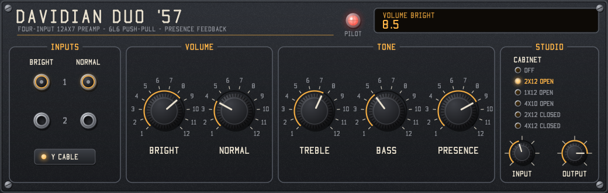

# Davidian Duo '57 — LV2 amp plugin

A Davidian LV2 model of a classic 1957 tweed 2x12 combo, solved stage by stage from its service diagram. It has four input jacks on Normal and Bright channels, a treble/bass tone stack, presence, a 6L6GC push-pull power amp with rectifier sag, and five speaker cabinet models. Mono in and out, no latency. Ready-built for Windows, macOS and Linux. Made with AI assistance; see [Use of AI](#use-of-ai).

## Download

Ready-built bundles are on the [Releases page](https://github.com/evadavevadave/davidian-duo-57/releases/latest):

| System | File | Contents |
|---|---|---|
| Windows 10/11, 64-bit | `duo57-windows-x64.zip` | `duo57.dll`, `duo57_ui.dll` (Win32 GUI) |
| macOS 10.13 or later, Intel and Apple silicon | `duo57-macos-universal.zip` | `duo57.dylib`, `duo57_ui.dylib` (Cocoa GUI) |
| Linux, x86_64 | `duo57-linux-x86_64.zip` | `duo57.so`, `duo57_ui.so` (X11 GUI) |

Each zip holds one `duo57.lv2` folder with the two .ttl files and the licences. GitHub Actions builds them from this repository's source (`.github/workflows/build.yml`) and runs the tests on each system before publishing. Unzip, then follow [Install](#install).

## Build and test on Windows

```
build.bat test
```

`build.bat` needs Visual Studio's C++ tools and finds them with `vswhere`. Without `test` it builds only the bundle. With `test` it also builds and runs three test programs in `build\`:

- `render.exe` checks the plugin against the schematic's test-point voltages and its rated power. It renders a synthetic chord through five settings and through each cabinet to `build\test_*.wav`. It checks that the cabinets are level-matched, and checks for NaN, glitches when switching input jacks or cabinets, and stability of the feedback loops.
- `ui_render.exe panel.bmp` renders the panel to an image without opening a window.
- `ui_check.exe duo57.lv2 window.bmp` loads the GUI the way a Windows host does and drives it with mouse messages.

## Install

Copy the whole `duo57.lv2` folder, from a downloaded zip or from `build/` after building, into one of the standard LV2 folders:

- Windows: `%APPDATA%\LV2` (current user) or `%COMMONPROGRAMFILES%\LV2` (all users)
- Linux: `~/.lv2` (current user) or `/usr/local/lib/lv2` (all users)
- macOS: `~/Library/Audio/Plug-Ins/LV2`

If your host doesn't scan that folder, add it to the host's LV2 search path or set the `LV2_PATH` environment variable. Close the host before copying and restart it afterwards. Replace any older copy instead of keeping two: when two bundles have the same URI, the loader uses one and ignores the other.

Look for **Davidian Duo '57** in your host's plugin list. The plugin URI is `urn:davidian:duo-57`.

**macOS:** the bundle isn't signed with a developer certificate or notarized, so macOS quarantines it after download and hosts may refuse to load it. Clear the quarantine flag once after copying:

```bash
xattr -dr com.apple.quarantine ~/Library/Audio/Plug-Ins/LV2/duo57.lv2
```

## Build on macOS and Linux

```bash
make
```

```bash
make test
```

```bash
make install
```

`make install` copies the bundle to `~/.lv2` (set `LV2DIR` for another folder; on macOS use `LV2DIR=~/Library/Audio/Plug-Ins/LV2`). `make dist` zips the bundle for release. The libraries get the right name for each system (`.so` or `.dylib`). The code is plain C, plus a small Objective-C window layer on macOS, and needs no LV2 SDK.

- **Linux:** needs a C compiler and the X11 development headers (`libx11-dev`).
- **macOS:** needs the Xcode command-line tools. Builds are universal (Intel and Apple silicon) by default; `make ARCH=` builds for this Mac's architecture only.
- **MinGW** (Windows with gcc) also works through the Makefile.

The GitHub Actions workflow builds and tests on Windows (MSVC), Ubuntu 22.04 and the current macOS on every push. The GUI host test (`ui_check`) is Windows-only; the macOS and Linux GUIs are checked by compiling them and rendering the shared panel code, not by opening a window.

## GUI



The bundle includes a native GUI in the house style: graphite panel, cream lettering, amber accents, black knurled knobs and outlined section boxes. `src/ui/style.h`, `font.h` and `canvas.h` are copied unchanged from the Bi-Lumen. The GUI draws every pixel with its own software renderer, shared by all three systems, and hands the result to a thin window layer: Win32 on Windows (`ui:WindowsUI`), Cocoa on macOS (`ui:CocoaUI`) and X11 on Linux (`ui:X11UI`). It needs no graphics libraries.

- **Input jacks:** click a jack to plug into it, and it lights amber. The Y CABLE button feeds Bright 1 and Normal 1 together, and both jacks light.
- **Knobs:** drag up or down. Hold Shift for fine control, use the mouse wheel for small steps, and double-click to reset. Volume, Treble, Bass and Presence carry a 1–12 scale, as on a tweed amp.
- **Cabinet selector:** click a row to choose it, or use the mouse wheel over the list. The lit amber lamp is the current choice.
- **Pilot light:** the red jewel is decoration and always lit.
- **Readout:** the window at the top right shows the control you last touched and its value.

The panel name, Duo '57, is original. It refers to the two speakers and the model year. The panel uses none of the original amp's logo, wordmark or artwork. Only the functional grouping follows the amp.

## Controls

| Control | Range | Default | Notes |
|---|---|---|---|
| Input Jack | Normal 1 / Normal 2 / Bright 1 / Bright 2 / Y cable | Bright 1 | Input 1 is about 6 dB hotter than Input 2. Y cable is Normal 1 and Bright 1 together |
| Volume Normal / Volume Bright | 1–12 | 6 | R18 / R19 1M. Bright has C4 100 pF across the pot. The unused channel's volume still loads the mixer, as on the real amp |
| Treble | 1–12 | 7 | R26 1M "A", with C7 250p and C8 47p |
| Bass | 1–12 | 5 | R30 1M "A", with C9 .01, C10 .0047 and R27/R28/R29 220k |
| Presence | 1–12 | 6 | R31 5k + C11 .1µF on the V4-A cathode. Turning it up lifts the treble and reduces treble in the negative feedback |
| Cabinet | Off / 2x12 Open / 1x12 Open / 4x10 Open / 2x12 Closed / 4x12 Closed | 2x12 Open | Speaker cabinet filter, see [Cabinets](#cabinets). Not on the amp. Off leaves the speaker-terminal signal for your own impulse response |
| Input Trim | -24 to +24 dB | 0 dB | 0 dBFS at the input counts as 1 V peak at the guitar jack |
| Output Level | -60 to +12 dB | 0 dB | Not on the amp. It comes after the circuit and doesn't change the tone |

### Cabinets

| Cabinet | Character |
|---|---|
| 2x12 Open | The amp's own speakers: open back, alnico magnets. Loose bass, a gentle mid scoop and a soft top. The default |
| 1x12 Open | A single 12" in an open-back cab. Less low end and more forward upper mids |
| 4x10 Open | Four 10" in an open-back cab. Deep but loose bass with a softer, earlier top roll-off |
| 2x12 Closed | The same two 12" in a sealed box. Tighter bass with a box thump around 100 Hz |
| 4x12 Closed | A sealed 4x12 with ceramic speakers. The biggest low end, a deeper mid scoop and a bright break-up peak |

Each cabinet is level-matched to the stock 2x12 over 100 Hz–5 kHz, so switching changes the tone rather than the volume; `render.exe` checks they stay within 3 dB (they measure within 0.6 dB). Switching crossfades over 20 ms, so it doesn't click. The Cabinet port's values 0 and 1 mean the same as the old on/off switch, so sessions saved with it load unchanged.

## How the model works

- **Input section:** four 12AX7 triodes (V1-A/B Normal, V2-A/B Bright). They share R9 470R ‖ C1 220µF, use 100k plate loads, and each pair is mixed through 100k resistors.
- **Volume and mixer:** the volume pots are modelled as Thevenin sources into the R20/R21 270k mixer, with the V3-A grid's input (Miller) capacitance.
- **V3 stages:** V3-A and the V3-B cathode follower are DC-coupled, so they are solved as one table. This includes grid conduction of the cathode follower through R23, and the R22 10M shunt-feedback loop, solved implicitly every sample.
- **Tone stack:** the full RC network, including the V4-A input capacitance, solved by nodal analysis with trapezoidal capacitor models. It is not a fitted curve.
- **V4-A and feedback:** V4-A has an unbypassed cathode. The R32 56k negative feedback from the speaker enters its cathode, and presence shapes both the stage gain and the feedback.
- **Phase inverter:** a cathodyne (V4-B), with swing limits.
- **Power amp:** 6L6GC push-pull, biased at −50.2 V for 33.3 mA per tube (note 7 on the schematic), with output-transformer bandwidth and plate saturation. The feedback loop is solved implicitly every sample.
- **Blocking:** power-tube grid current charges C13/C14, which shifts the bias the way a cranked tweed amp does.
- **Rectifier sag:** 5U4 rectifiers, choke and 22µF reservoir.
- **Triodes:** every 12AX7 stage uses the Koren equations, solved on that stage's AC load line into a lookup table when the plugin loads.
- **Oversampling:** everything runs at 4x with 12th-order anti-alias filters. A single instance runs about 7–9 times faster than real time on the build machine.

## Measured against the schematic

Note 6 of the schematic gives AC test-point voltages for 10 mV at 1 kHz into J3 (Bright 1), with all controls at 50%. The schematic allows ±20%. `render.exe` prints the model's value at each point.

| Point | Model | Schematic | Difference |
|---|---|---|---|
| TP14 (C3 node) | 554 mV | 488 mV | +14% |
| TP15 (V3-A grid) | 60 mV | 50 mV | +20% |
| TP16 (cathode follower) | 3.09 V | 2.51 V | +23% |
| TP17 (V4-A grid) | 371 mV | 261 mV | +42% |
| TP23 (speaker, 4 Ω) | 3.76 V | 2.6 V | +45% |
| Power at full clipping | 36 W | 30 W RMS at 5% THD | — |

The input stages are within the schematic's tolerance. From TP16 on the model runs hot: TP17 and TP23 are 3 dB above the schematic. The power figures aren't like for like: the model's 36 W is at full clipping, not at 5% THD.

## Estimates

The schematic doesn't settle these, so they are judgment calls. Tune them by ear:

- **Jack switching:** the scan's jack drawing alone suggests that Input 1 drives only one triode. But a single 12AX7 cannot reach the TP14 gain of 48.8× with this load. With both triodes driven, the model gives about 55×. So Input 1 is modelled as driving both triodes, and Input 2 as driving one, with the other grid grounded.
- **Volume taper:** the volume pots are marked "SPL. D", which doesn't say what law they follow. A linear law reproduces the TP14 → TP15 ratio at 50% rotation, so that is what is used. Treble and bass use a standard audio taper.
- **Power-amp constants:** the 6L6GC curve, output-transformer saturation and sag depth.
- **Cabinet filters:** all five are shaped by ear from the usual character of each cabinet type, not from measured speakers or impulse responses. Their curves are in the `CABS` table in `src/duo57.c`.

## Simplifications

These parts are behavioural models, not a component-level circuit solution:

- the cathodyne's swing limits
- the 6L6GC, which uses a 3/2-power law
- output-transformer saturation
- rectifier sag
- the cabinet filters, which are six-band EQ curves rather than speaker models: they don't model cone break-up distortion, mic position or room

Power-supply ripple isn't modelled, and the preamp supply doesn't sag with the power amp.

## Code layout

| File | Contents |
|---|---|
| `src/duo57.c` | DSP, cabinet models and LV2 entry points |
| `src/ports.h` | Port numbers, cabinet numbers and URIs shared by the plugin and the GUI |
| `src/lv2_core.h` | The LV2 C interface, so no SDK is needed. Build with `-DHAVE_LV2` to use the system headers instead |
| `src/ui/panel.h` | GUI layout, drawing and mouse handling, with no platform code |
| `src/ui/style.h`, `canvas.h`, `font.h` | House style, software renderer and stroke font |
| `src/ui/ui_lv2.c` | LV2 UI entry points and the Win32 and X11 window layers |
| `src/ui/window_cocoa.h` | The macOS (Cocoa) window layer, in Objective-C |
| `duo57.lv2/` | LV2 metadata. The build fills in the library extension and GUI type in `manifest.ttl.in` |
| `test/render.c` | Test-point calibration, power, rendered WAVs, NaN, jack-switching and stability checks |
| `test/ui_check.c` | Hosts the built GUI and drives it with mouse messages (Windows only) |
| `test/ui_render.c` | Renders the panel to a .bmp file |
| `build.bat`, `Makefile` | Windows (MSVC) build, and the macOS, Linux and MinGW build |
| `.github/workflows/build.yml` | Builds and tests on all three systems, and publishes releases from version tags |
| `LICENSE`, `LICENSE-LV2` | GPL-3.0 text, and the ISC notice for the re-declared LV2 interface |

## References

The model re-implements equations from these published works. No code was copied from them.

1. N. Koren, "Improved vacuum tube models for SPICE simulations", *Glass Audio* 8(5), 1996. The 12AX7 triode equation and parameters.
2. R. Bristow-Johnson, "Cookbook formulae for audio EQ biquad filter coefficients" (the Audio EQ Cookbook). The low-pass, high-pass and peaking filters in the anti-alias and cabinet filters.
3. V. Zavalishin, *The Art of VA Filter Design*, Native Instruments, 2012–2020. The topology-preserving one-pole filters.
4. K. Karplus and A. Strong, "Digital synthesis of plucked-string and drum timbres", *Computer Music Journal* 7(2), 1983. Only used to make the test signal in `test/render.c`.

## Use of AI

This project was made with AI assistance. The code, tests, LV2 metadata, build scripts and this README were written by Claude (Anthropic's Claude Opus 5.5, through Claude Code), directed and reviewed by the author.

- **The author** supplied the schematic, the GUI house style, the names and the licensing choices. They also decided what to build and changed parts of the result themselves, including renaming the project to Duo '57.
- **The AI**:
  - read component values and topology from the scanned schematic and chose the estimates listed under [Estimates](#estimates)
  - wrote the DSP model and calibrated it against the schematic's test points
  - designed the five cabinet curves
  - adapted the house-style GUI to this panel and wrote the macOS window layer
  - wrote the test programs, the build scripts and CI workflow, and the documentation
- **Checking:** the results are checked by the automated tests described above:
  - test-point levels and power against the schematic
  - numerical stability, jack and cabinet switching, cabinet levels and speed
  - the GUI loaded and driven by simulated mouse input (Windows)
  - builds and DSP tests on Windows, macOS and Linux in CI
- **Not checked:** the sound hasn't been compared with a real amplifier, and the plugin hasn't been tried in a host yet. The macOS and Linux GUIs compile but haven't been opened in a host. The values under [Estimates](#estimates) should be tuned by ear.

## License

Copyright (C) 2026 Davidian

This program is free software: you can redistribute it and/or modify it under the terms of the GNU General Public License as published by the Free Software Foundation, either version 3 of the License, or (at your option) any later version. It is distributed in the hope that it will be useful, but WITHOUT ANY WARRANTY; without even the implied warranty of MERCHANTABILITY or FITNESS FOR A PARTICULAR PURPOSE. See [LICENSE](LICENSE) for the full text.

## Third-party licences

| Component | Licence | How it's used |
|---|---|---|
| LV2 C interface (`lv2/core/lv2.h`, `lv2/ui/ui.h`) | ISC | Its declarations are re-stated in `src/lv2_core.h`, the UI ABI block of `src/ui/ui_lv2.c` and `test/ui_check.c`, so no LV2 SDK is needed. Copyright and permission notice in [LICENSE-LV2](LICENSE-LV2). |
| LV2 vocabularies (`lv2core`, `ui`, `units`) | ISC | The `.ttl` files refer to them by URI. Nothing is copied. |
| Microsoft C runtime | Visual Studio licence | `build.bat` links it statically (`/MT`) into the DLLs you build. It counts as a system library under the GPL, so this is allowed. No binaries are committed to this repository. |
| Apple Cocoa, Core Graphics; X11 (libX11) | System libraries | The macOS and Linux GUIs link them dynamically. Nothing is copied. |
| GitHub Actions (`actions/checkout`, `upload-artifact`, `download-artifact`, `softprops/action-gh-release`) | MIT | Used only by the CI workflow to build and publish releases. Not part of the plugin. |

Every source file starts with an SPDX licence line saying which of these applies.

This project is not affiliated with or endorsed by the maker of the original amplifier. Valve type numbers (12AX7, 6L6GC, 5U4) are generic industry designations.
